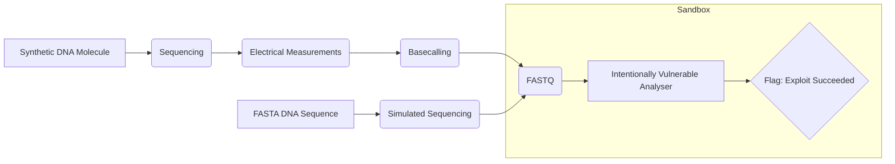

## The Greatest Line in TV History

Earlier today, I was watching a TV show, enjoying some downtime from work. In the episode, a virus had been released in the area, so the CDC came in to contain it. While they were analysing the virus, every computer in the room suddenly stopped working, started making strange noises, and displayed enormous "ACCESS DENIED" messages.

Now, obviously the way this was portrayed was ridiculous, but I can usually overlook things like that for the sake of a bit of fun. What came next, though, might be the greatest line in TV history:

> *“What's happening?”*
>
> *“I have no idea, but it seems like the biological virus is now infecting our entire network!”*

This actually made me laugh out loud. Frankly, I loved it. It might be the tackiest thing I've heard all month. But it also got me thinking:

*“Is this actually possible?”*

I thought about it for maybe 30 seconds before coming to the conclusion that, yeah, it is theoretically possible.

Imagine a piece of software designed to analyse DNA sequencing data. If that software has a vulnerability, you could theoretically encode the bytes needed to exploit it within the DNA itself. After all, DNA is an extraordinarily dense way of storing information. Once the DNA is sequenced and the resulting data is processed, those encoded bytes could trigger the vulnerability.

That immediately jumpstarted the whole thing, and so here I am, an hour later, writing this.

## Not So Theoretical

After a bit of research, I found a paper detailing this. A group of researchers at the University of Washington had already done what I wanted to do back in 2017. You can read the paper [here](https://dnasec.cs.washington.edu/dna-sequencing-security/dnasec.pdf).

The interesting thing is that it does **exactly** what I had in mind. That doesn't bother me, though. This isn't research, so a lack of originality or uniqueness is more than fine with me. I just think it's very cool. In fact, I'm glad the paper exists, because it offers some valuable insight into what I'm trying to do.

I won't give a full summary of the paper. If you're interested, the best thing to do is read it yourself. Instead, I want to focus on the details that caught my attention and might be useful for my own project.

This is especially important because I'm neither a biologist nor a chemist. The most I've done is some high-school-level biology and chemistry, so nothing remotely close to this calibre. That's okay, though. It has never discouraged me before, and I've often found myself in this position.

First, the software. They used a real FASTQ compression tool called `fqzcomp` and deliberately introduced a buffer overflow vulnerability. To make the proof of concept work reliably, they disabled stack canaries and ASLR, and made the stack executable. This is effectively a best-case scenario for an attacker, which the authors discuss in the paper.

Second, they encoded an exploit into actual synthesised DNA, ordered it through IDT's gBlocks synthesis service, and had it sequenced on an Illumina NextSeq. When the vulnerable program processed the resulting FASTQ file, it opened a reverse shell back to their server.

That already gives me a starting point for my own setup. The FASTQ format and the synthesis service, in particular, are useful pieces of information for later.

I'd argue that the more interesting details, though, are the challenges they ran into. Those give me a much clearer idea of the roadblocks I might face.

First, synthesis constraints. Synthesis services can reject sequences containing long homopolymer runs, excessively repetitive regions, or GC content outside roughly 25–75% within a given window. Their first attempt ran into all three problems.

After that first attempt, they switched to a shorter exploit: a return-to-libc attack calling `system()` and using Bash's `/dev/tcp` feature for the network callback. They used a short domain and a single-digit port to keep the payload tiny: 43 bytes, or roughly 176 bases. Lowercase ASCII letters also conveniently encoded as Cs, which helped keep the GC content within acceptable bounds.

Next, reliability. The attack was probabilistic. Sequencing introduces errors, and reads can come out in either orientation, so only about 37% of reads carried working, forward-direction exploit code. Across the sequencing lanes, the reported probability of success was approximately 84.5%.

Finally, an accidental side channel: sample bleeding. Their sample was multiplexed, meaning it was sequenced alongside samples from other teams, as is common practice. They noticed that their results contained DNA from a neighbouring sample. This phenomenon was already known to biologists as a source of inaccuracy, but the paper explored its implications as a security channel. Because the contamination can go both ways, an attacker could potentially use it to inject or leak data.

That's fairly concerning from a security standpoint, but it's well outside the scope of what I want to do here.

The authors also go into detail about existing software, its security issues, practical implications, and more. I highly recommend giving the paper a read.

So, as a complete beginner, my main takeaways are:

1. The FASTQ file format
2. A potential synthesis service
3. Specific synthesis limitations
4. What worked in their experiment
5. The probabilistic nature of the attack

## The Plan

I'm going to write down a plan to give myself some structure, although I expect it might change as I go.

The first step is to simulate everything on the software side. It makes sense to start with a program that accepts a FASTQ-formatted input and does something with it. I'm not quite sure what yet. From there, I'll deliberately introduce a basic buffer overflow vulnerability, just as the researchers did. It's simply the easiest way forward.

Next, I'll write the exploit. Again, I'm not entirely sure what it will do yet, but I'll probably keep it simple and fairly close to what the researchers did, to avoid as many potential complications as possible. Path of least resistance.

In theory, that should give me a deterministic result. Once I have it working, the next step will be to introduce the probabilistic side of things: read fragmentation, occasional substitutions, and so on. The idea is to gradually move towards a more realistic setup. Perhaps I could even simulate the entire sequencing process.

Once I'm happy with the simulation, it'll be time to look more seriously into DNA synthesis, the ordering process, and my sequencing options.

The good news is that I've already looked into this a little. Synthesis seems surprisingly accessible — hopefully ASICs will be like that one day, too — but sequencing is what concerns me more.

The first thing I checked was whether I could get the sequencing hardware myself. The cheapest option I could find was the Oxford Nanopore MinION Mk1D:


💀

Now, I don't know about you, but I'm not that rich. So... moving on.

The next option is a sequencing service. Essentially, I'd order the synthetic DNA, send the sample to a sequencing facility, and get the resulting reads back.

That would be straightforward enough. The thing is, I'd really love to be there in person, either to do it myself or at least to see it happen.

Which brings me to option three: find someone crazy enough to let my idiotic ass into their lab and touch their expensive equipment.

I'm not sure how realistic that is, though. Even if I found someone willing, I have no training or experience, and I'd rather not have to order a pile of extra samples to make up for that.

Finally, the last step would be to put together the full end-to-end chain and see what happens.

Roughly speaking, I imagine the final setup looking something like this:



I'm using FASTA for the simulation branch since it's a simpler format. That makes it a convenient way to represent the DNA sequence before any simulated sequencing takes place. The simulator can then process it as though it were a real sample and produce FASTQ data.

## The Analyser

I think the best place to start is by building the target software itself. It's also the perfect opportunity to learn a little more about DNA and the FASTQ format.

Before going any further, I think it's worth briefly explaining how DNA and FASTQ work, especially since I knew very little about either when I started this project.

At its simplest, DNA (deoxyribonucleic acid) is a sequence of four different bases: adenine (A), thymine (T), cytosine (C), and guanine (G). These bases form the genetic information stored in DNA, and their order is what matters to us. From a computer's perspective, we can essentially think of DNA as a very long string made up of four possible characters.

Of course, reading that string from an actual DNA molecule is a bit more complicated. That's where DNA sequencing comes in. Sequencers attempt to determine the order of bases in a DNA sample, producing what are called *reads*. These are generally shorter sequences, and importantly, they're not necessarily perfect. Errors can occur, and the sequencer has varying levels of confidence in each base it identifies.

This brings us to FASTQ, a file format commonly used to store these reads. It's actually a remarkably simple format. Each record consists of four lines:

```text
@read_001
ACGTTGCAACGT
+
IIIIIIIIIIII
```

The first line is an identifier, the second contains the actual nucleotide sequence, the third is a separator, and the fourth contains encoded quality scores. Each character in that last line corresponds to a base in the sequence, representing how confident the sequencer is that it identified it correctly.

There's also FASTA, a simpler format that stores sequences without quality scores. This is particularly useful for my simulation, since I can start with an ideal DNA sequence in FASTA and simulate the sequencing process to produce a more realistic FASTQ file.

And that's really all we need to know for now. The important distinction is that the DNA itself isn't executing anything. It's simply carrying information, which eventually gets converted into data that a computer processes. If the software processing that data has a vulnerability, that's where things get interesting.

The program is fairly simple. It takes a FASTQ file as input, validates and parses it, and produces an overview of its contents.

The nice thing is that, once you understand how FASTQ is structured, parsing it is fairly straightforward. So the program itself doesn't need to be particularly complicated.

A simple Makefile handles the build, using GCC with the following flags: `-std=gnu23 -march=native -Ofast -flto -Wall -Wextra -Werror`.

A couple of things are worth mentioning here. I use `-march=native` because I expect to run the binary on my own machine. Even if someone else wants to run it, the repository is set up so they'll compile it locally, targeting their own hardware.

The other interesting choice is `-Ofast`. In GCC, this includes `-O3`, `-ffast-math`, and a few other optimisations that don't strictly conform to the language standards. I generally prefer `-Ofast` over `-O3` when I don't need strict floating-point behaviour, since it gives the compiler more freedom to reassociate operations, which can be especially useful for SIMD reductions. A slight detour, but I thought it was worth mentioning.

To be fair, none of this matters much for the exploit. The deliberately vulnerable build will disable optimisations anyway.

After asking Claude to generate a sample FASTQ file, here's what the analyser produces:


I have to say, I really enjoyed writing some simple, raw C again. Between work and a general lack of time, I haven't had many opportunities lately to sit down and write code in my favourite programming language purely for the sake of it. I think that's why I appreciated this part of the project so much.

## The Exploit Chain

With the analyser out of the way, it's time for the important bit: introducing the vulnerability. I'm going with a basic stack buffer overflow — effectively baby's first vulnerability.

The real analyser doesn't give me one for free. It reads each line using `getline()`, storing the data in heap buffers that grow to accommodate whatever they're given. There's no obvious fixed-size buffer to overflow. So, to create the bug, I have to add one myself: a fixed-size stack buffer into which an attacker-controlled FASTQ field is copied without a bounds check.

As with any security project, I like to keep this work sandboxed. Not that anything here is remotely dangerous, but it's a good discipline. It also lets me separate concerns, keep the weakened security settings in one place, and leave the real program untouched. The original analyser still validates its input and has none of these deliberately introduced vulnerabilities. (If it has an accidental one, that would be pretty embarrassing.)

The sandbox therefore reuses most of the real program, swapping out only the parts I need to weaken. Four original source files — `main.c`, `report.c`, `reader.c`, and `error.c` — are compiled unchanged. Two sandbox-local files, `stats.c` and `validate.c`, take the place of their original counterparts. Everything else, from reading and reporting to the record structure, is the genuine analyser. With ordinary input, the sandbox build behaves just like the original.

The vulnerability itself lives in the sandbox's `stats.c`, in the routine that adds a record's bases to the running totals. It still counts the bases as before, but afterwards it copies the entire sequence line into a 256-byte stack buffer using `memcpy()`, without checking the length. A read of up to 256 bases fits, so everything behaves normally. A longer read runs past the end of the buffer and overwrites whatever happens to be next on the stack. That's the whole bug.

Of course, causing a crash is one thing; controlling the overflow is another. A long sequence of valid bases might be enough to crash the program, but I want to control it with arbitrary bytes. That's where the second modified file comes in.

The real validator rejects anything that isn't a nucleotide, so it would reject the payload before it reached the vulnerable buffer. The sandbox's `validate.c` deliberately skips that check for sequences longer than 256 bases, immediately reporting them as valid. That lets an oversized record containing arbitrary bytes pass validation and reach the vulnerable copy. The two modifications work together: one lets the payload through, and the other gives it somewhere to do damage.

(The sandbox's `stats.c` also contains a small `win` function that the original has no reason to include. Nothing calls it during normal operation; it's simply a recognisable target for the hijacked control flow.)

## Where I'm Leaving It

At this point, I think it's time to leave the project here. It's been almost a month since I last worked on it and was last writing this entry. Simply put, the initial spark faded a bit and other things took priority.

I'm focusing on quite a few other things in my life right now, and with the limited time I have, I feel that other projects deserve more attention.

I still think this is a pretty cool project, but synthesising DNA and then sequencing it feels like an expensive hassle for something so small in scope. I'd also be doing it without the backing of an institution, which would likely make the process far more tedious, with additional regulations, costs, and paperwork to deal with.

Not that any of that has stopped me before, but I mean, look at this:


Just looking at this makes me want to live reclusively in the mountains and never look back.

So I'm happy to leave it here. I've simulated the whole thing digitally, and I'm satisfied with that.

The simulation wasn't exhaustive: I ran the full deterministic simulation, and also deliberately introduced a few probabilistic properties in a couple of brief experiments. Everything largely went as I imagined it would, minus a segfault hiccup.

Maybe one day I'll find the motivation to take it further, but I'm also fairly certain I'm already on three lists 🤷‍♂️.

Anyway, as always, thanks for reading!

You can find the repository [here](https://github.com/Arty3/dna-security).